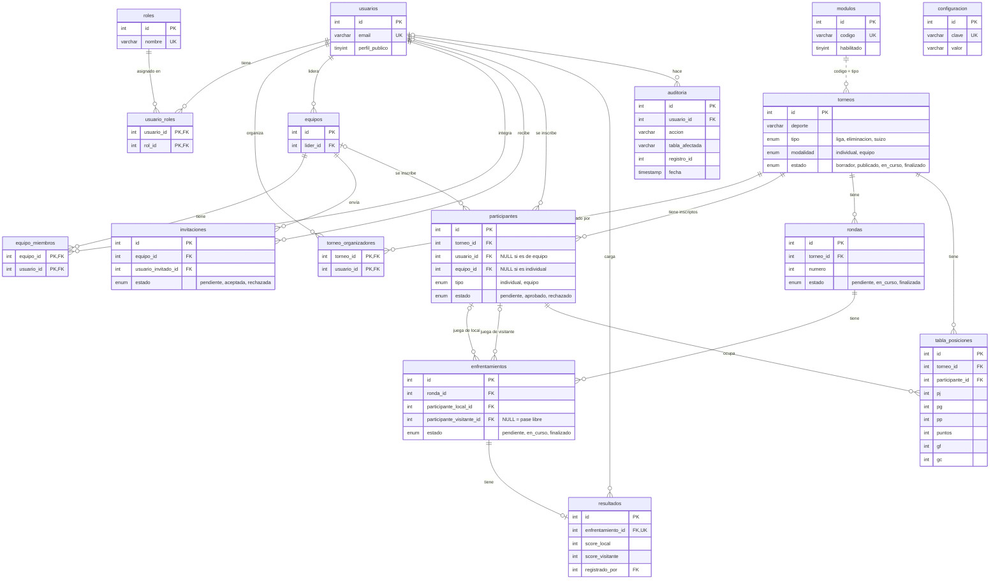

# MER del enunciado vs. base de datos real

El MER de `Requerimientos.pdf` (resumido en [`requerimientos.md`](requerimientos.md#modelo-mer-resumen)) fue el plano inicial. La base que se entrega es la de [`database/tornea.sql`](../database/tornea.sql), y durante el desarrollo algunos nombres y valores cambiaron. Este documento dice a qué tabla real corresponde cada cosa del MER y por qué.

Si se consulta la base con los nombres del MER, MySQL no siempre avisa: una tabla que no existe da error, pero un valor de enum que no existe (por ejemplo `estado = 'cerrado'`) simplemente devuelve 0 filas.

## Entidades → tablas

En la base las tablas van en plural.

| MER | Tabla real | Qué cambia |
|---|---|---|
| `usuario` | `usuarios` | Igual. `perfil_publico` lo elige cada persona al editar su perfil, pero todavía no hay una página pública de perfiles (ver "Fuera de alcance"). |
| `rol` | `roles` | Igual: `admin`, `organizador`, `participante`. |
| `usuario_rol` | `usuario_roles` | La tabla permitiría varios roles por persona, pero la app maneja uno solo: al crear su primer torneo, un participante pasa a organizador, y cuando el admin cambia un rol, reemplaza el anterior. |
| `participante` | `usuarios` | No hay tabla aparte: la persona que juega es un usuario. No se exige un rol para inscribirse, solo que no sea organizador de ese torneo. |
| `inscripcion` | `participantes` | **Ojo con el nombre:** cada fila es alguien anotado en un torneo, no la persona. Tiene `usuario_id` o `equipo_id` (uno de los dos, según la modalidad del torneo; lo controla la app, la base no lo impide) y un `estado` para que el organizador apruebe o rechace. |
| `equipo` | `equipos` | Los equipos son permanentes (no tienen `torneo_id`): se arman una vez y se inscriben en varios torneos. Tienen un `lider_id`. |
| `equipo_participante` | `equipo_miembros` | Une `equipos` con `usuarios`. |
| `torneo` | `torneos` | Se agregó `modalidad` (`individual` o `equipo`) y `deporte`. |
| `modulo` | `modulos` | Cada tipo de torneo es un módulo. `modulos.codigo` coincide con `torneos.tipo` (no hay clave foránea). |
| `configuracion` | `configuracion` | Pares `clave` / `valor`: `puntos_victoria`, `puntos_empate`, `minimo_participantes`. |
| `ronda` | `rondas` | Igual, con `numero` de ronda. |
| `encuentro` | `enfrentamientos` | En vez de referencias a participante o equipo, tiene `participante_local_id` y `participante_visitante_id`, que apuntan a `participantes` (y esa fila ya dice si es una persona o un equipo). Sin visitante = pase libre. |
| `resultado` | `resultados` | Relación 1 a 1 con `enfrentamientos` (`enfrentamiento_id` es UNIQUE). Guarda quién lo cargó en `registrado_por`. |
| `posicion` | `tabla_posiciones` | Una fila por inscripción aprobada, así sirve para torneos individuales y por equipo. Guarda `pj`, `pg`, `pp`, `puntos` y los goles a favor y en contra (`gf`, `gc`), que sirven para desempatar: se ordena por puntos, diferencia (`gf - gc`), goles a favor, partidos ganados y, por último, nombre. Si los dos primeros quedan iguales en todo, el torneo no tiene campeón y la pantalla avisa el empate. Los empates no se guardan, se calculan como `pj - pg - pp`. Se vuelve a armar entera cada vez que se carga un resultado. La eliminación directa no tiene tabla. |
| `auditoria` | `auditoria` | Igual: quién (`usuario_id`), cuándo (`fecha`), qué hizo (`accion`) y sobre qué registro (`tabla_afectada` + `registro_id`). |

## Enums

| Columna | MER | Base real | Equivalencia |
|---|---|---|---|
| `torneos.tipo` | `liga`, `eliminacion_directa`, `suizo` | `liga`, `eliminacion`, `suizo` | `eliminacion_directa` → `eliminacion` |
| `torneos.estado` | `borrador`, `publicado`, `en_curso`, `cerrado` | `borrador`, `publicado`, `en_curso`, `finalizado` | `cerrado` → `finalizado` |
| `rondas.estado` | `generada`, `publicada`, `cerrada` | `pendiente`, `en_curso`, `finalizada` | ver abajo |
| `enfrentamientos.estado` | `pendiente`, `en_curso`, `finalizado` | `pendiente`, `en_curso`, `finalizado` | Igual. En la práctica se usan `pendiente` y `finalizado`: el partido pasa a finalizado cuando se carga el resultado. Los pases libres (sin visitante) se crean ya en `finalizado` y no tienen resultado. |

Estados de una ronda:

- `pendiente`: ya existe pero todavía no se juega. Pasa en la liga, que arma todas las rondas al arrancar.
- `en_curso`: se está jugando y se le pueden cargar resultados. Equivale a `generada` + `publicada` del MER: apenas se genera, ya se ve en el detalle del torneo.
- `finalizada`: cerrada, sus resultados ya no cambian. Equivale a `cerrada`.

## Lo que la base tiene y el MER no

| Qué | Para qué |
|---|---|
| Tabla `torneo_organizadores` | La base admite varios organizadores por torneo. Hoy la app solo registra a quien lo crea. |
| Tabla `invitaciones` | El líder de un equipo invita a alguien y esa persona acepta o rechaza (`pendiente`, `aceptada`, `rechazada`). |
| `torneos.modalidad` | Define si el torneo es entre personas o entre equipos. Al publicar se bloquea, junto con `deporte` y `tipo`. |
| `participantes.estado` | La inscripción queda `pendiente` hasta que el organizador la aprueba o la rechaza. Solo juegan los aprobados. |
| `participantes.tipo` | Repite si la inscripción es `individual` o de `equipo`. |
| `equipos.lider_id` | La persona que maneja el equipo y lo inscribe en torneos. |

## Fuera de alcance

Lo que afecta al modelo de datos. El detalle (por qué y cómo se haría) y el resto de lo que quedó afuera están en [`fuera-de-alcance.md`](fuera-de-alcance.md).

- **RF-40 — Publicar rondas.** No existe el estado `publicada`: una ronda se ve en cuanto se genera.
- **RF-45 — Validar resultados.** No hay un estado de "resultado validado"; el marcador se valida al cargarlo.
- **RF-53 — Ver perfiles públicos.** La columna `usuarios.perfil_publico` existe, pero no hay una página donde otra persona vea un perfil.

## Diagrama de la base real

GitHub dibuja este diagrama al abrir el archivo. Se muestran las claves y las columnas que importan para entender las relaciones.

